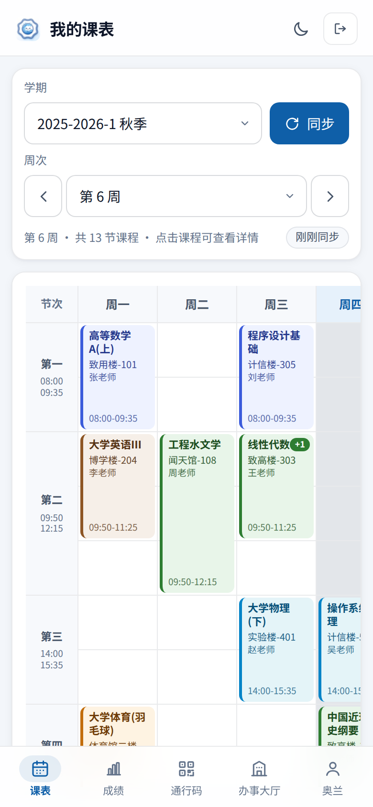
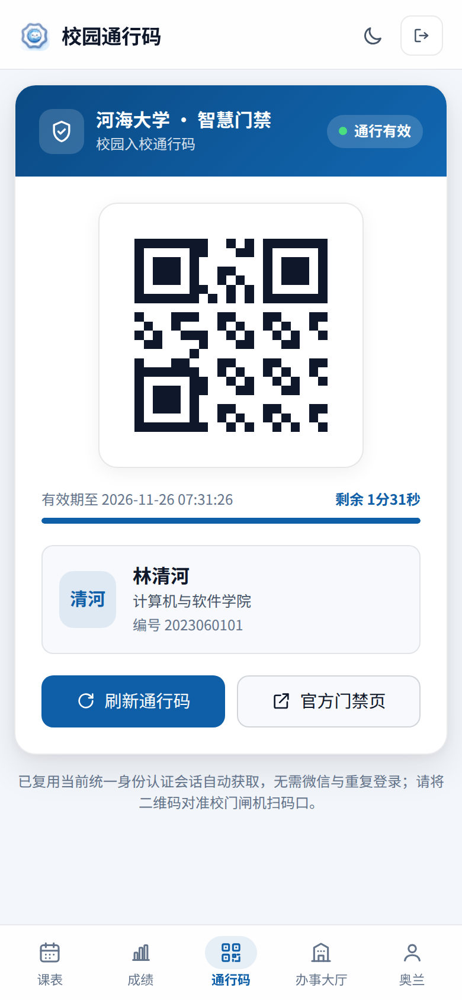

# HHU+ — 河海大学一站式校园助手

> 👤 **普通用户**请看 [USER_GUIDE.md（用户指南）](USER_GUIDE.md)（安装 / 使用 / 常见问题）。
> 🛠 **开发者**请继续往下读。
> 课表 · 成绩 · 校园通行码 · 办事大厅 · 奥兰系统，一次登录全畅用。
> 一份抓取引擎跑三端：**APK（离线）/ Web（浏览器）/ CLI**。

HHU+ 是面向河海大学在校生的开源校园助手，把日常高频使用的教务课表、学业成绩、校园通行码（原微信门禁 H5）、办事大厅与奥兰系统收进一个优雅现代的统一界面。它**不是官方应用**，所有数据均实时来自河海大学官方系统，仅供学习与个人使用。

---

## 功能一览

| 功能 | 说明 |
|---|---|
| 📅 **课表** | 周视图双向冻结窗格；快速前后切周、今日高亮、多课重叠自动折叠为 `+N` 徽标、点击弹出课程详情、本地缓存离线可读 |
| 📊 **成绩** | 河海蓝 GPA 汇总卡 + 成绩等级分布条 + 课程实时搜索/排序 + 卡片式明细（同时支持百分制数字与优秀/良好等中文等级着色） |
| 🪪 **校园通行码** | **新增！** 直连河海智慧门禁系统（`zhjc.hhu.edu.cn`），复用统一身份认证自动单点换票，无需微信、无需重登；高对比纯白扫码区 + 实时倒计时 + 过期一键刷新 |
| 🏛 **办事大厅** | 一键免重登进入河海办事大厅（`taskcenter`），支持请假审批、教室申请等（APK 共享原生 Cookie，Web 经认证反向代理免登嵌入/新标签打开） |
| 👤 **奥兰系统** | 一键免重登进入奥兰学生管理信息系统（`smst.hhu.edu.cn`），移动版视图适配，支持离校登记、宿舍管理等 |

**一次登录，五大功能全免重登**；支持亮色 / 深色主题切换、桌面端左侧导航栏 + 移动端底部导航自适应，认证过期时支持单飞静默续期（含 30 分钟节流防风控）。

 

> 以上为示例界面（模拟数据，非真实信息）。更多界面截图与安装说明见 [USER_GUIDE.md](USER_GUIDE.md)。

---

## 架构：一份代码三端复用

```
请求流
  APK(WebView)  功能模块 → 抓取引擎(浏览器环境, 离线) + MainActivity Cookie 桥 + InAppBrowser
  浏览器(Web)   功能模块 → Node 后端(Express + CookieJar + SSO 代理) → 同一份抓取引擎(Node)
  终端(CLI)     cli.js → 同一份抓取引擎
```

- **唯一抓取引擎**：`web/js/engine/`（CAS 登录 / AES-CBC / 课表 / 成绩 / 智慧通行码 CAS 换票与自动续期）。
- **域/路径感知 CookieJar + 手动重定向跟踪**：`server/cookie-jar.js` + `server/node-env.js`，修复中间 302 跳转丢失 `CASTGC` 与多域 Cookie 冲突问题。
- **Web 端免重登 SSO 代理**：`server/proxy.js` 严格限定仅代理 `*.hhu.edu.cn`，复用服务端会话 CookieJar，让浏览器端打开办事大厅与奥兰也不必重新登录。
- **可插拔功能模块**：`web/js/features/*.js`（一功能一文件，自注册），`web/js/config.js` 为全项目唯一常量源。

## 技术栈

| 层 | 技术 |
|---|---|
| 前端 / 引擎 | 原生 JS（ES Modules）+ 原生 CSS 设计系统（亮/暗双主题），零前端框架 |
| Web 后端 | Node.js + Express + RFC 感知 CookieJar + SSO 反向代理 |
| APK | Capacitor 8（Android WebView 壳 + 自研 `HHUCookieHelper` 读写落盘桥） |
| 测试 | `node --test` + HTML fixture + AES 已知答案 + 通行码/代理/CookieJar 单测 |

## 目录结构

```
web/                       # Capacitor webDir：APK 离线运行的全部内容
├─ index.html              # 响应式应用壳（登录 / 桌面侧栏 / 手机底栏 / 弹窗抽屉）
├─ css/
│  ├─ tokens.css           # 河海深海蓝 + 素瓷灰 亮/暗双主题设计变量
│  └─ components.css       # 全套组件与响应式样式
└─ js/
   ├─ config.js            # ★ 唯一常量源（学校域名 / URL / ZHJC 接口 / Cookie 路径表）
   ├─ engine/
   │  ├─ scraper.js        # 登录 / 导航 / 成绩 / 课表 / 通行码 SSO
   │  └─ parser.js         # 纯解析函数 + AES-CBC + 等级分级 + Ticket 提取
   ├─ platform/
   │  ├─ apk.js            # APK：原生 fetch + 多路径 cookie 落盘 + InAppBrowser
   │  ├─ web.js            # Web：fetch → /api + 会话校验恢复 + /proxy 免登入口
   │  └─ index.js          # 运行环境自动选择
   ├─ features/            # ★ 可插拔功能模块（一功能一文件）
   │  ├─ index.js          # 功能注册表
   │  └─ schedule.js  grades.js  passcode.js  classroom.js  orlan.js
   ├─ store.js             # localStorage 状态与缓存持久化
   ├─ ui.js                # Toast / 弹窗抽屉 / 时间与下拉工具
   ├─ icons.js             # 统一线性 SVG 图标系统
   └─ app.js               # 薄装配器（主题 / 双端导航 / 单飞静默续期）

server/                    # Web 模式后端（Node + Express）
├─ server.js               # 静态 web + /api/* + /proxy/* + 统一错误处理
├─ cookie-jar.js           # 域/路径感知 CookieJar
├─ node-env.js             # linkedom + 手动重定向跟踪 fetch
├─ proxy.js                # 仅限 *.hhu.edu.cn 的免重登 SSO 反向代理
└─ session.js              # 滑动 TTL 内存会话管理 + 定期清理

cli.js                     # CLI：查成绩 / --passcode 查通行码 / --cookie-file 回退
tests/                     # node --test 单元与回归测试
scripts/                   # APK 构建脚本与示例截图生成校验脚本
android/                   # Capacitor Android 工程（含 MainActivity.java Cookie 桥）
```

## 快速开始

### Web 模式（浏览器 + 本地后端）

```bash
npm install
npm run server            # 默认 http://127.0.0.1:5000（支持 .env 配置 PORT/HOST）
```

### CLI 模式

```bash
# 建一个「账密.txt」，两行：
#   账户：<学号>
#   密码：<密码>
node cli.js --credential-file 账密.txt [--semester "2025-2026-1"]
# 获取校园通行码信息：
node cli.js --credential-file 账密.txt --passcode
# Cookie 回退（应对验证码）：
node cli.js --cookie-file cookies.json
```

### APK 模式（Capacitor）

```bash
npm install
./scripts/setup-android-sdk.sh    # 一次性安装 Android SDK
./scripts/build-apk.sh            # cap sync + gradlew assembleDebug
# 产物：android/app/build/outputs/apk/debug/app-debug.apk
```

## 测试

```bash
npm test                  # node --test tests/*.test.js
```

## 隐私 & 安全

- 本项目**不含任何账号、密码或个人数据**。
- 凭据仅在登录时提交至河海大学官方统一身份认证；勾选「保持登录状态」时仅保存在本机 `localStorage`，主动退出将彻底清除。
- Web 模式反向代理严格限制白名单仅允许 `*.hhu.edu.cn`。

## License

> MIT（详见 `LICENSE` 文件）
