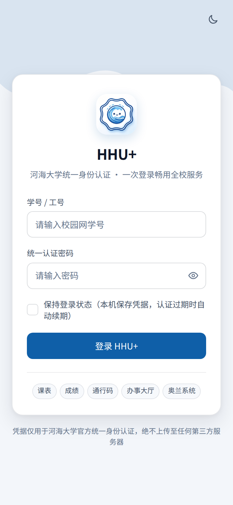

# HHU+ 用户指南

河海大学一站式校园助手 —— 把**课表、成绩、校园通行码、办事大厅、奥兰系统**收进一个简洁优雅的应用，一次登录，全功能免重登。

> 本指南面向普通用户。开发者请看 [README.md](README.md)。

---

## 核心功能

| 功能 | 说明 |
|---|---|
| 📅 **我的课表** | 周视图双向冻结窗格；支持 `< / >` 快速切换周次、今日高亮、多课重叠显示 `+N` 徽标、点击课程看详情，并支持离线查看缓存课表 |
| 📊 **学业成绩** | 河海蓝 GPA 汇总卡 + 成绩等级分布条 + 课程搜索/排序 + 卡片式明细（百分制与优秀/良好等五级制均支持梯度着色） |
| 🪪 **校园通行码** | 直接生成河海大学智慧门禁入校通行码，**无需打开微信、无需重复登录**；纯白高对比扫码区 + 实时倒计时 + 过期一键刷新 |
| 🏛 **办事大厅** | 一键免登进入学校办事大厅（请假审批、教室申请等） |
| 👤 **奥兰系统** | 一键免登进入奥兰学生管理信息系统（离校登记、宿舍管理等） |

支持**浅色 / 深色模式**切换（右上角图标），在手机与电脑浏览器上均有原生适配布局。

## 界面预览

| 登录 | 课表 | 成绩 | 校园通行码 |
|---|---|---|---|
|  |  |  |  |

> 上图均为示例模拟数据，不含任何真实个人信息。

## 使用步骤

1. 打开 HHU+，输入**学号 + 校园网统一认证密码**登录。
2. 建议勾选「**保持登录状态**」，本机将在认证真正过期时自动静默续期（30 分钟节流防风控）。
3. 登录后默认展示**我的课表**，可通过底部导航（桌面端为左侧导航）自由切换**课表 / 成绩 / 通行码 / 办事大厅 / 奥兰**，全程**无需重复登录**。
4. 进出校门时切换到**通行码**即可直接展示二维码扫码通行；如过期点击遮罩或「刷新通行码」即可秒刷。
5. 点击右上角退出图标并确认，将安全退出并清除本机保存的登录态与缓存。

## 常见问题

| 问题 | 处理 |
|---|---|
| 登录提示需要验证码 | 学校认证偶发触发验证码风控，请稍后再试或使用 CLI 的 Cookie 回退模式 |
| 认证过期怎么办 | 勾选「保持登录状态」后会自动在后台静默续期一次；若在 30 分钟节流期内请手动点一次登录 |
| 通行码过期或扫不出来 | 点击二维码上的「刷新通行码」获取最新动态码，并将屏幕调亮对准闸机扫码口；如需办理访客审批/人脸采集可点击「官方门禁页」 |
| 网页端办事大厅/奥兰内嵌显示异常 | 点击顶部栏的「新标签页」按钮即可在完整免登标签页中打开，无需重新输入密码 |

## 隐私与安全

- 账号密码仅提交给河海大学官方统一身份认证，绝不上传至任何第三方服务器。
- 退出登录时会清除本机保存的凭据、Cookie 与课表/成绩缓存，避免多账号混用。
