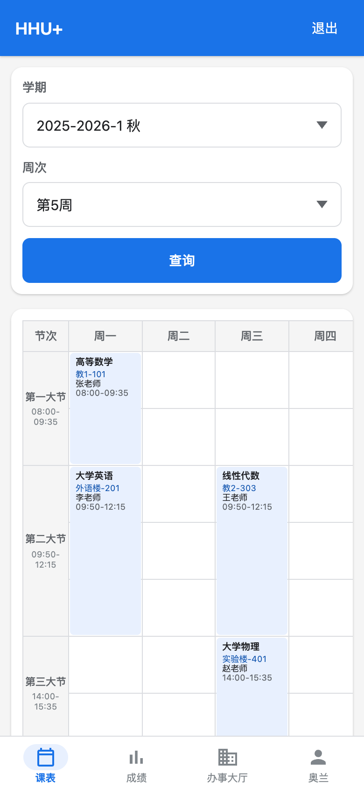
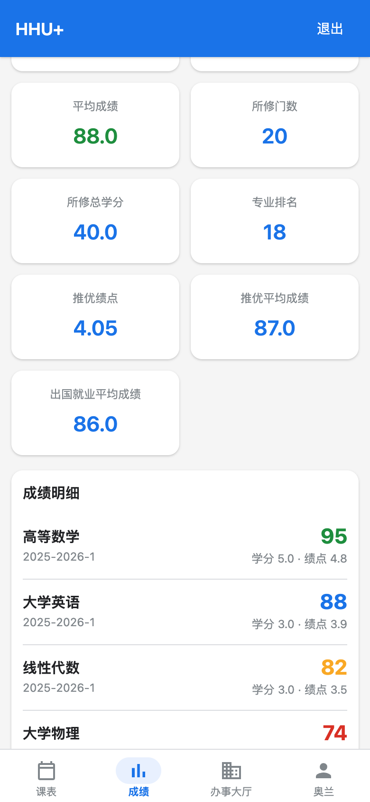

# HHU+ 用户指南

河海大学信息门户手机版 —— 把课表、成绩、办事大厅、奥兰系统收进一个手机 APP。

> 本指南面向普通用户。开发者请看 [README.md](README.md)（GitHub 首页）。

---

## 能干什么

| 功能 | 说明 |
|---|---|
| 📅 课表查询 | 周视图，选学期/周次，切换查看；表头行与"节次"列双向冻结，横滑纵滑都看得清 |
| 📊 成绩查询 | GPA 统计卡片 + 卡片式成绩列表（按分数梯度着色：高分绿 → 低分紫），无需横向滚动 |
| 🏛 办事大厅 | 一键进入学校办事大厅（taskcenter） |
| 👤 奥兰系统 | 一键经 CAS 单点登录进入奥兰学生管理信息系统 |

一次登录，四个功能都能用；**跳转奥兰/办事大厅免重新登录**。

## 界面预览

**登录页**

**课表（周视图，带双向冻结窗格）**

**成绩（GPA 统计 + 卡片式列表，分数梯度着色）**

> 上图均为示例数据，仅演示布局，非真实成绩。

## 如何安装

### Android 手机（推荐）

1. 下载 `HHU+.debug.apk`；
2. 传到手机（微信/QQ/数据线均可），点击安装；
3. 若提示"未知来源"，在系统设置里允许安装即可。

> 说明：`-debug` 版本为开发签名，仅用于自用/体验；如需正式发布版，开发者需出 `release` 签名包。

### 电脑浏览器（Web 版）

需要在电脑上运行一个本地后端（开发者可参考 README 启动）。普通用户用手机装 APK 最省事。

## 使用步骤

1. 打开 APP，输入**学号 + 校园网密码**登录（与学校信息门户同一套账号）。
2. 登录后默认进入**课表**，可切换学期/周次查询。
3. 点底部**成绩**看 GPA 统计与全部课程成绩。
4. 点**办事大厅 / 奥兰**直接跳转（免重登）。
5. 可勾选"**自动登录**"，下次打开免输账号（账号密码存在本机）。

## 常见问题

| 问题 | 处理 |
|---|---|
| 登录提示要求验证码 | 学校 WebVPN 触发验证码时无法自动登录；等会再试，或用「Cookie 回退」（详见 README） |
| 提示"会话已过期" | 学校会话过期，会自动重登；若在 30 分钟内且被节流，请稍候或手动登录 |
| 用着用着说"课表/成绩结构变化" | 学校页面改版，需开发者更新解析（见 README 的测试与 fixture） |
| 成绩页 GPA 少几项 | 以学校教务系统实际返回为准，页面没有的指标不会显示 |
| 奥兰/办事大厅变成电脑版 | 首次打开正常；若二次打开变电脑版，请在应用内清除缓存后重进（开发者已在持续修复） |

## 隐私与安全

- 账号密码**只在登录时提交**给学校 WebVPN，本应用不存储、不上传到其它服务器。
- 「自动登录」会把账号密码保存在**你自己手机的本地存储**里；退出登录会清除。
- 本应用是**非官方开源项目**，与河海大学无关；请遵守学校规定，合理使用，勿高频访问（学校有风控，滥用账号可能被封）。
- 数据仅供参考，以学校教务系统为准。

## 反馈 & 贡献

欢迎河海的校友同学提 Issue、提想法，或在 [README.md](README.md) 里了解如何加入开发。
